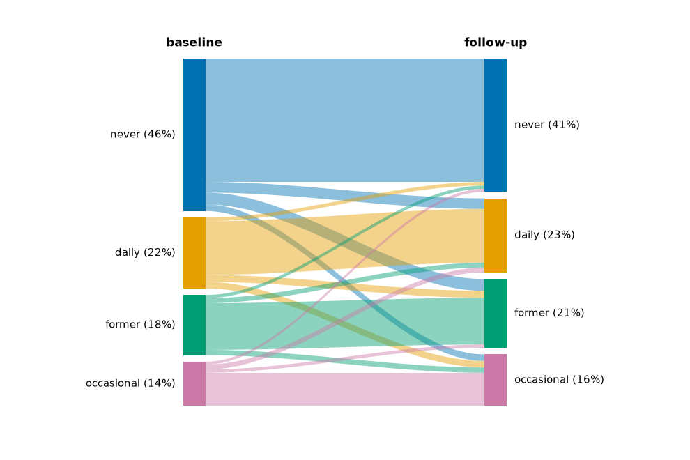
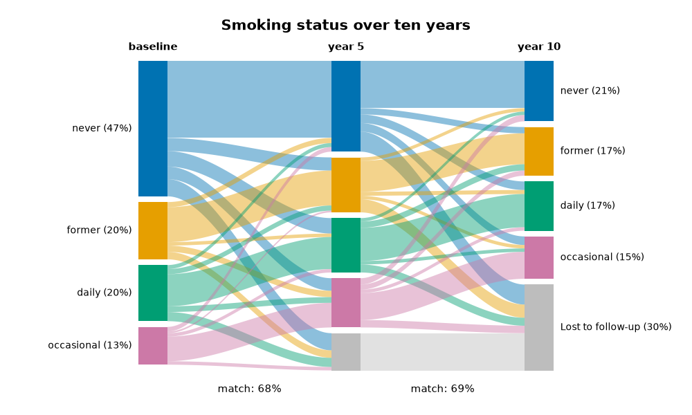

# pastallapy

Longitudinal data plotting helpers that are named after the pasta they look like.

First on the menu: **`tagliatelle`** — a sankey diagram with ribbons flowing
between two or more sets of categories, tracking e.g. how a categorical
variable evolves over time.

## Install

```bash
pip install pastallapy
```

## Use

It needs is a dataframe with (at lerast) two categorical columns.

```python
import pastallapy as pp
import numpy as np
import pandas as pd

rng = np.random.default_rng(1)
levels = ["never", "former", "occasional", "daily"]
n = 500

baseline = rng.choice(levels, size=n , p=[0.45, 0.2, 0.15, 0.2])
follow_up = np.where(rng.random(n) < 0.6, baseline, rng.choice(levels, size=n))
smoking = pd.DataFrame({"baseline": baseline, "follow-up": follow_up})

pp.
```



Out of the box the function picks a colourblind-friendly palette, orders the
categories by size and uses the *same* order on both sides (so whatever did not
change runs straight across), labels each bar with its share, and takes the
column headers from the column names.

## More than two timepoints

Name as many columns as you have stages — or none, to use every column of the
dataframe. Ribbons are drawn between each neighbouring pair, and the categories
keep one order and one set of colours throughout, so a row that never changes
runs straight across the whole plot.

Real follow-up data has holes in it. `missing=` turns those `NaN`s into a
category of their own instead of dropping the rows, which is what makes dropout
visible:

```python
rng = np.random.default_rng(1)
levels = ["never", "former", "occasional", "daily"]
n = 500

baseline = rng.choice(levels, size=n, p=[0.45, 0.2, 0.15, 0.2])
year5 = np.where(rng.random(n) < 0.6, baseline, rng.choice(levels, size=n))
year10 = np.where(rng.random(n) < 0.6, year5, rng.choice(levels, size=n))

smoking = pd.DataFrame({"baseline": baseline, "year 5": year5, "year 10": year10})

# Dropout: once someone is lost to follow-up, they stay lost.
lost = rng.random(n) < 0.12
smoking.loc[lost, ["year 5", "year 10"]] = np.nan
lost |= rng.random(n) < 0.15
smoking.loc[lost, "year 10"] = np.nan

pp.tagliatelle(
    smoking,                        # no column names: all three are stages
    missing="Lost to follow-up",    # None would drop these rows instead
    title="Smoking status over ten years",
    show_agreement=True,            # the "match:" figure under each gap
    margin_x=0.2,                   # room for the longest label
    figsize=(10, 6),
)
```



The grey band is everyone who has left the study: nothing at baseline, 13% by
year 5, 30% by year 10. It always gets the neutral colour rather than one from
the palette, and it sits out the `match:` figures, which compare only the people
seen at both ends of that interval. Its position is decided by size like any
other category — pass `labels=` to fix the order of the real categories, and the
missing group is kept at the bottom.

## Options

```python
pp.tagliatelle(
    smoking, "baseline", "follow-up",
    labels=["never", "former", "daily"],   # which categories, top to bottom
    other="Other",                         # where the rest go (None drops them)
    missing="Lost to follow-up",           # NaN as a category (None drops those rows)
    title="Smoking status over nine years",
    side_titles=("Baseline", "Nine years later"),
    show_agreement=True,                   # "match: 78%" beneath the plot
)
```

| argument | what it does |
| --- | --- |
| `data`, `left`, `right` | a dataframe plus two column names, or `left=`/`right=` arrays. With a two-column dataframe, the names can be left out. |
| `weights` | column or array of weights, for data that is already aggregated. |
| `labels` | categories to keep, in drawing order. One sequence for both sides, or `(left_labels, right_labels)` to order them separately. Anything left out is grouped into `other`. |
| `ax` | draw into an existing axes instead of a new figure. |

Anything about the appearance is a keyword too:

```python
pp.tagliatelle(
    smoking, "baseline", "follow-up",
    palette={"never": "#4C9F70", "daily": "#C1484E"},  # partial maps are fine
    curve=0.5,                 # 0 straight, 1 fully eased
    gap=0.03,                  # space between bars, as a share of the total
    node_width=0.05,
    ribbon_color="right",      # or "left", or a single colour
    ribbon_alpha=0.3,
    label_template="{label}\n{value:.0f} ({percent})",
    label_wrap=18,
    margin_x=0.12,             # blank figure kept beyond the outermost label
    figsize=(9, 7),
)
```

Reuse a look by keeping the style object around:

```python
house = pp.TagliatelleStyle(palette="tab20", font_size=8, curve=0.6)
pp.tagliatelle(smoking, "baseline", "follow-up", style=house)
pp.tagliatelle(other_data, "before", "after", style=house, gap=0.05)  # one-off tweak
```

`pp.TagliatelleStyle` inherits from `pp.Style`, which holds the defaults shared
by every plot in the package (palette, fonts, figure size), so new shapes added
later start from the same look.

## The number under the plot

`show_agreement=True` writes the share of the data that stayed in the same
category. The same number without the plot:

```python
pp.agreement(smoking, "baseline", "follow-up")            # 78.375
pp.agreement(smoking, "baseline", "follow-up", exclude=["Other"])
```

Categories in `exclude` are dropped from both sides first, so a catch-all group
cannot count as a match.

## Notes

- The function returns the matplotlib axes, so `ax.figure.savefig(...)` and the
  usual matplotlib handling all work.
- Bar labels sit outside the axes. In a figure of its own, the axes narrows
  until the labels clear `margin_x` on either side, so long labels push the
  diagram in rather than off the page — widen `margin_x` for even more room, or
  set `fit_labels=False` to leave the axes where matplotlib put it. When you
  pass your own `ax`, leave room yourself (or shorten the labels with
  `label_wrap` / `label_template`).
- Weights must be finite and non-negative; rows with zero weight are skipped.
